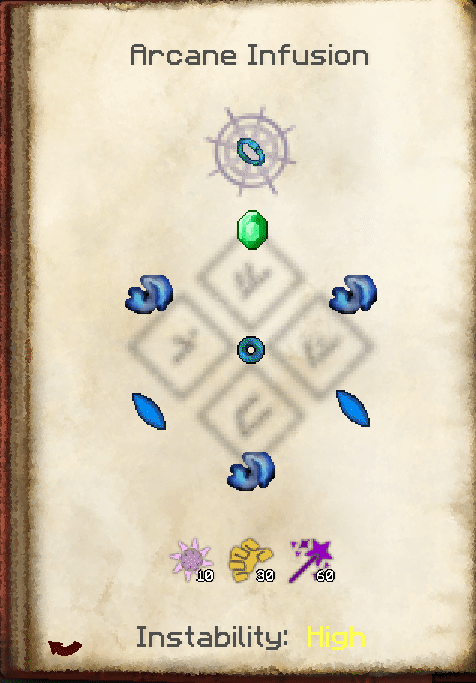
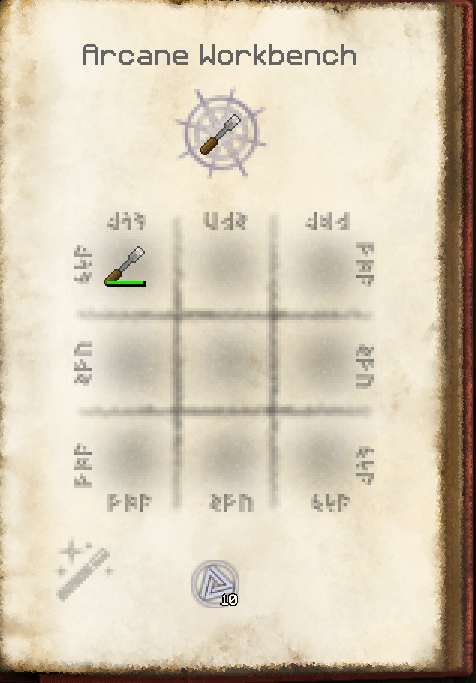

ModTweaker2
==========
ModTweaker is an addon for MineTweaker 3. Minetweaker lets you adjust recipes, remove them entirely, or add new recipes. While it has decent mod support, there are many mods that use custom crafting handlers that are not supported natively. ModTweaker plans to provide additional support for as many of these mods over time as possible.

This is a small fork of mine
----------
In it I added support for showing several recipes on one page in thaumonomicon:

 
